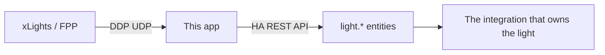

# xLights DDP Entity Bridge

[](https://github.com/alexbbt/ha-xlights-ddp-bridge/releases/latest)
[](LICENSE)

Home Assistant app (formerly an add-on) that receives [DDP](https://www.3wayplc.com/ddp-by-3way/) from **xLights** or **Falcon Player (FPP)** and maps each RGB pixel to a `light.*` entity, at a slow rate those lights can keep up with.

Any Home Assistant light that accepts `light.turn_on` and `light.turn_off` can be a pixel. A cloud light that waits for a reply is one reason to use it. Govee is the device this was measured against. The same mapping works for Hue, a Wi‑Fi bulb, or any other `light.*` entity.

Point xLights at a WLED or Twinkly controller directly. Use this app for ordinary Home Assistant lights.

## Install

This needs **Home Assistant OS** or **Supervised**. Container and Core installs do not have Apps.

[](https://my.home-assistant.io/redirect/supervisor_add_addon_repository/?repository_url=https%3A%2F%2Fgithub.com%2Falexbbt%2Fha-xlights-ddp-bridge)

That opens the add-repository dialog on your own Home Assistant, with this address filled in. To add it yourself:

1. **Settings → Apps → Install app**
2. Open the **⋮** menu at the top right and choose **Repositories**
3. Add `https://github.com/alexbbt/ha-xlights-ddp-bridge`
4. Install **xLights DDP Entity Bridge** and start it
5. **Open Web UI** and replace the example lights. The first light is pixel 0. The **Configuration** tab edits the same list as text.
6. In xLights or FPP, add a **DDP** controller aimed at the IP address of the machine running Home Assistant. Set the channel count to `3 ×` the number of lights.

The app listens on UDP port **4048**. If the show network is on another VLAN, allow that port through to Home Assistant.

It runs on 64-bit Home Assistant (aarch64 or amd64).

To pick up a newer version, open the app and choose **Check for updates**.

## How it connects



Each configured `entity_id` is one RGB pixel.

## Open Web UI

**Open Web UI** picks lights from Home Assistant, reorders them, and shows live traffic. The Configuration tab edits the same settings as text.

- Search, add, remove, and reorder lights. Order is DDP pixel order.
- Status: Home Assistant health, DDP listen address, last xLights/FPP sender, packets per second, payload size, and a color swatch per pixel
- Tests: Home Assistant connection, pulse white, all off
- A short event list. The app **Log** tab has the full history.

Saving lights or `hz` applies immediately. Changing `ddp_port` or `ddp_bind` needs a restart of the app.

## Configuration

| Option | Default | Meaning |
|--------|---------|---------|
| `hz` | `2` | Max updates per second to Home Assistant |
| `ddp_port` | `4048` | UDP listen port |
| `ddp_bind` | `0.0.0.0` | Bind address |
| `lights` | example placeholders | Ordered list of `entity_id`s. Pixel 0 is the first entry. |

`1` Hz is a safe rate. `2` Hz is the measured ceiling for a Govee light that waits for a reply. Anything faster depends on the device.

Each update waits for Home Assistant to finish before the next light is touched. Two slow lights in one tick can take longer than `1 / hz`, so that tick misses the rate cap.

What gets sent:

- `rgb(0,0,0)` turns the light off
- Any other color turns it on with `rgb_color`, and `brightness` set to the highest of R, G, and B
- A pixel that did not change color is left alone
- The color Home Assistant shows is whatever that integration reports. xLights gamma and the brightness calculation both change it. Match the look in xLights, on the controller, if you need it closer.

Replace the example entities before you run a show. Pixel 0 is the first entry.

```yaml
hz: 2
ddp_port: 4048
ddp_bind: "0.0.0.0"
lights:
  - entity_id: light.example_pixel_1
  - entity_id: light.example_pixel_2
```

### One whole light

Map the entity for the whole light. Per-segment entities are the wrong target when the integration has to use the cloud: each segment is another call, and that call waits before the next light is touched.

```yaml
hz: 2
ddp_port: 4048
ddp_bind: "0.0.0.0"
lights:
  - entity_id: light.porch
```

A light that accepts `rgb_color` can take a color. Other lights still turn on and off.

## xLights or FPP

1. Add a network controller:
   - Protocol: **DDP**
   - IP: the IP address of the machine running Home Assistant
   - Channels: `3 ×` the number of lights
2. Put a model on that controller, for example a Single Line with one node per light
3. Prefer slow color changes. High-speed twinkles and chases pile up on a light that waits for a reply.
4. Allow UDP from the show network to Home Assistant on port **4048** (or whatever you set for `ddp_port`)

## Troubleshooting

| What you see | What to check |
|--------------|----------------|
| Nothing happens | The log should say `Listening DDP…`. In the Web UI, Status should show packets while xLights is outputting. |
| Home Assistant errors | Start the app after Home Assistant itself is up. Use **Test HA connection** on the Web UI. |
| Web UI tests work, FPP does not | UDP from the player to the Home Assistant machine on port **4048** is blocked. Status shows the last sender once a packet arrives. |
| Lights lag or skip | Use `1` Hz. `2` Hz is the measured ceiling for a Govee light that waits for a reply. Two slow lights in one tick can miss that cap, because each update waits for Home Assistant before the next light is touched. |
| The wrong light changes | Pixel 0 is the first `entity_id`. Reorder the list on the Web UI. |

## Help

Questions and bugs: [open an issue](https://github.com/alexbbt/ha-xlights-ddp-bridge/issues/new/choose). Include the app version, `hz`, `ddp_port`, how many lights, and the relevant log lines.

Security reports: [SECURITY.md](SECURITY.md).

Development and releases: [CONTRIBUTING.md](CONTRIBUTING.md). Please follow the [Code of Conduct](CODE_OF_CONDUCT.md).

## License

[MIT](LICENSE) © Alexander Bell-Towne
